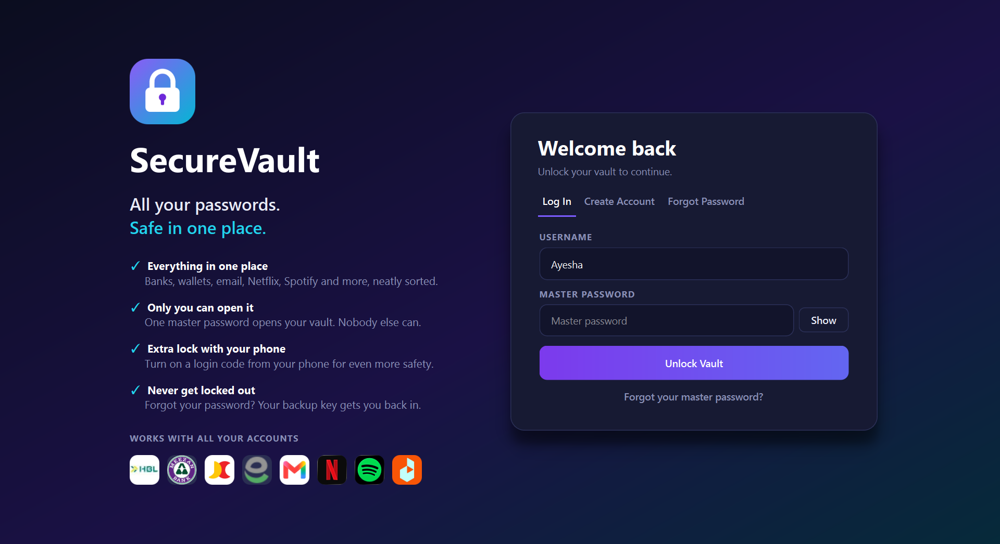
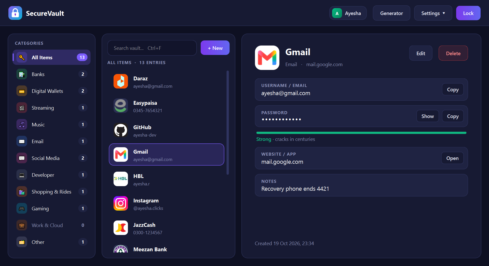

# SecureVaultPM

A professional, open-source desktop password manager built with Python and PySide6. All passwords are encrypted end-to-end on your local machine — no cloud, no telemetry, no third-party servers.




---

## Features

- **Categories** — Banks, Digital Wallets, Streaming, Music, Email, Social Media, Developer, Shopping & Rides, Gaming, Work & Cloud, and Other, with live counts in a sidebar
- **Real brand logos** — 90+ services (HBL, UBL, MCB, Meezan, Alfalah, JazzCash, Easypaisa, Netflix, Spotify, Gmail, GitHub, Daraz...) bundled offline; the service is picked from a list or detected from the website you type
- **Plain-language interface** — friendly wording for everyday users ("backup key", "2-step login") with no crypto jargon on screen
- **AES-256-GCM encryption** — authenticated encryption detects tampering; wrong key never silently decrypts to garbage
- **Argon2id key derivation** — memory-hard KDF (64MB, 3 iterations) resists GPU/ASIC brute-force attacks
- **Zero-knowledge design** — your master password is never stored; only a wrapped key derived from it is kept
- **Per-user Data Encryption Key (DEK)** — rotating your master password never requires re-encrypting the vault
- **SQLite storage** — every field of an entry, including its category and service, is encrypted as one blob before touching the database
- **Multiple user accounts** — each user has a completely independent vault and key
- **Two-Factor Authentication (TOTP)** — compatible with Google Authenticator, Authy, and any RFC 6238 app
- **Backup (recovery) key** — a high-entropy offline key that can reset your master password without data loss
- **Encrypted backup key file (`.svrk`)** — the key is saved in an app-only encrypted file; opened in a text editor it is scrambled text
- **Master password rules** — at least 8 characters with an uppercase letter, a number and a special character, and it cannot be your username (or username + digits)
- **Responsive, non-blocking UI** — key derivation runs in the background, so the window never freezes while unlocking
- **Keyboard shortcuts** — `Ctrl+N` new entry, `Ctrl+F` search, `Ctrl+G` generator, `Ctrl+L` lock, `Del` delete, `Esc` clear search
- **Password generator** — cryptographically secure, configurable length/charset, avoids ambiguous characters
- **Password strength meter** — powered by zxcvbn (realistic crack-time estimates, not just character-class rules)
- **Auto-lock** — vault locks automatically after configurable inactivity (default 5 minutes)
- **Clipboard auto-clear** — copied passwords are wiped from the clipboard after 25 seconds
- **Brute-force lockout** — account temporarily locks after 5 failed login or backup-key attempts

---

## Security Architecture

```
Master Password
      │
      ▼ Argon2id (64MB, 3 iter, 4 threads)
  KEK (Key Encryption Key)
      │
      ▼ AES-256-GCM wrap
  Wrapped DEK ──────────────────────── stored in SQLite
      │
      │ (unwrapped at login, held in memory only)
      ▼
   DEK (Data Encryption Key)
      │
      ▼ AES-256-GCM encrypt per entry
  Vault Item Blobs ─────────────────── stored in SQLite
```

The recovery key wraps the same DEK independently, so either the master password or the recovery key can unlock the vault.

---

## Requirements

- Python 3.10+
- Windows / macOS / Linux

---

## Installation

```bash
git clone https://github.com/yourusername/securevaultpm.git
cd securevaultpm

python -m venv venv

# Windows
venv\Scripts\activate

# macOS / Linux
source venv/bin/activate

pip install -r requirements.txt
```

> **Note:** `PySide6-Essentials` is ~79MB. If your connection is slow, download the wheel manually from [PyPI](https://pypi.org/project/PySide6-Essentials/6.7.2/#files) and install it with:
> ```bash
> pip install PySide6_Essentials-6.7.2-cp39-abi3-win_amd64.whl
> pip install -r requirements.txt
> ```

---

## Running

```bash
python main.py
```

---

## Project Structure

```
securevaultpm/
├── main.py               # Entry point, app wiring, inactivity guard
├── requirements.txt
├── app/
│   ├── brands.py         # Categories and the brand catalog (name, category, domain, logo)
│   ├── crypto.py         # Argon2id KDF, AES-256-GCM encrypt/decrypt, DEK wrap/unwrap
│   ├── db.py             # SQLite schema and all parameterized queries
│   ├── auth.py           # Register, login, change password, account recovery
│   ├── vault.py          # Vault item CRUD, password generator, strength checker
│   ├── totp.py           # TOTP 2FA setup, QR generation, code verification
│   ├── recovery.py       # Recovery key file write/read, key rotation
│   └── paths.py          # OS-appropriate app data directory
├── assets/logos/         # Bundled 128px brand logos (no network access at runtime)
└── ui/
    ├── styles.py          # Qt stylesheet (dark theme)
    ├── security.py        # InactivityGuard, ClipboardGuard
    ├── auth_window.py     # Login / Register / Recovery tabs
    ├── main_window.py     # Vault list, search, actions, settings menu
    └── dialogs.py         # Item editor, password generator, 2FA setup, recovery key display
```

---

## Data Storage

Vault data is stored locally at:

| Platform | Path |
|----------|------|
| Windows  | `%APPDATA%\SecureVaultPM\vault.db` |
| macOS    | `~/Library/Application Support/SecureVaultPM/vault.db` |
| Linux    | `~/.local/share/SecureVaultPM/vault.db` |

The `.db` file contains only encrypted blobs. Without the master password or recovery key it is unreadable.

---

## Recovery Key

At registration you receive a 256-bit recovery key (base32, grouped for readability):

```
XXXX-XXXX-XXXX-XXXX-XXXX-XXXX-XXXX-XXXX-XXXX-XXXX-XXXX-XXXX-XXXX
```

You can save it as an encrypted `.svrk` file and load it later from **Forgot Password → Open Backup Key File**. The file is encrypted with a key built into the app, so it protects against casual reading and tampering, not against someone with the source code — treat it like the key itself.

**Store it offline** (USB drive, printed copy, safe). Anyone with this key and your username can reset your master password. SecureVaultPM has no server — if you lose both your password and this key, vault data cannot be recovered.

---

## Trademarks

Brand names and logos shown in the app belong to their respective owners. They are used only to help you recognise which service a saved password belongs to, and do not imply any endorsement or affiliation.

---

## License

MIT
